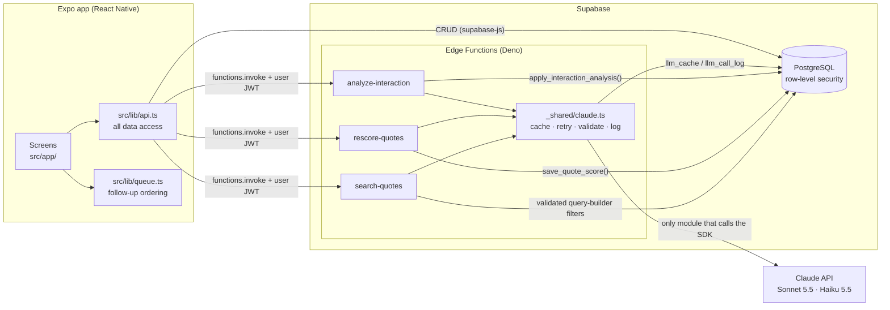

# Window CRM

A mobile CRM for a window-cleaning business, with AI features built on the Claude API.
Built with Expo (React Native), Supabase (PostgreSQL, Auth, Edge Functions) and TypeScript.

**Core CRM**

- **Clients**: name, phone, email, address and notes, with search, tap to call or email, and directions in Maps
- **Quotes**: amount, description and status (draft / sent / accepted / declined), plus a "schedule job from this quote" button
- **Interactions**: the history with each client (emails, calls, site-visit notes, general notes), optionally linked to a quote
- **Schedule**: a month calendar of jobs. Jobs can be one-off or repeat every N weeks or months.
- **Reminders**: local notifications before each job, with defaults you set and overrides per job

**AI features (Claude API)**

- **Analyze an interaction**: Claude summarizes an email or note. It extracts to-dos with due dates and a follow-up date, and can update the quote's status. The reply is structured JSON, validated before anything is saved.
- **Lead scoring**: every open quote gets a 0–100 score for how likely it is to be accepted, based on its interaction history, with a short rationale.
- **Follow-ups tab**: a daily queue. Overdue and due-today items come first, then open quotes by lead score.
- **Ask AI search**: plain-English questions like _"open quotes over $500 created this month"_ become validated database filters, using tool use.
- **Reliability and cost control**: retries with exponential backoff, response caching, and a log of tokens, cost and latency for every AI request, with totals in Settings.

## Screenshots

<!-- Add images to docs/screenshots/ and uncomment.
| Follow-ups | Analyze an email | Ask AI search | AI usage |
| --- | --- | --- | --- |
|  |  |  |  |
-->

_Screenshots coming soon: Follow-ups queue, interaction analysis, Ask AI search, and Settings → AI usage._

## Architecture



- **The app never holds the Claude API key.** It calls Supabase Edge Functions with the signed-in user's token. The key lives only in Supabase secrets.
- **Edge Functions act as the user.** `withSupabase({ auth: 'user' })` gives each function a database client limited by the same row-level security policies as the app. A function can only read and write the caller's own rows.
- **One module talks to Claude.** Every AI request goes through `callClaude()` in [`supabase/functions/_shared/claude.ts`](supabase/functions/_shared/claude.ts). Handlers never use the SDK directly.

## Setup

### 1. Supabase project and database

1. Create a project at <https://supabase.com/dashboard>.
2. Open **SQL Editor**, then paste and run each file in [`supabase/migrations/`](supabase/migrations/) **in filename order**:

   | File | Adds |
   | --- | --- |
   | `20261103000000_init.sql` | clients, quotes, jobs, job series, settings, RLS |
   | `20261104010000_client_single_address.sql` | single address field on clients |
   | `20261104020000_delete_own_account.sql` | in-app account deletion |
   | `20261109000000_job_months_and_address.sql` | monthly repeating jobs, job addresses |
   | `20261109010000_interactions.sql` | interaction history |
   | `20261109020000_seed_demo_data.sql` | `seed_demo_data()` for the demo |
   | `20261110000000_llm_cache_and_log.sql` | AI response cache, AI usage log |
   | `20261110010000_interaction_analysis.sql` | action items, summaries, follow-up dates |
   | `20261110020000_quote_scores.sql` | lead scores |

   Alternatively, after linking the CLI (step 2), run `npx supabase db push`.

3. Under **Authentication → Sign In / Providers → Email**, you can turn off "Confirm email" so you can sign in straight away.
4. Once you've created your own account in the app, turn off **Allow new users to sign up** so nobody else can register.

### 2. Edge Functions and the Claude API key

The Supabase CLI is a dev dependency, so there's nothing extra to install.

```sh
npm install
npx supabase login
npx supabase link --project-ref <your-project-ref>

# Put your Anthropic API key in supabase/functions/.env (this file is gitignored)
cp supabase/functions/.env.example supabase/functions/.env
# ...edit it, then upload it as a secret. The key never goes into the app or git.
npx supabase secrets set --env-file supabase/functions/.env

npx supabase functions deploy analyze-interaction rescore-quotes search-quotes
```

Optional: override the models with the `CLAUDE_SUMMARY_MODEL`, `CLAUDE_SEARCH_MODEL` and `CLAUDE_SCORING_MODEL` secrets. The defaults are in [`_shared/config.ts`](supabase/functions/_shared/config.ts).

### 3. App config

```sh
cp .env.example .env.local
```

Fill in `EXPO_PUBLIC_SUPABASE_URL` and `EXPO_PUBLIC_SUPABASE_PUBLISHABLE_KEY` from **Project Settings → API Keys**, and set `EXPO_PUBLIC_CURRENCY` (e.g. `GBP`, `USD`, `EUR`).

### 4. Run on your phone

```sh
npx expo start
```

Install **Expo Go**, then scan the QR code (on iPhone, with the Camera app). Your phone and PC need to be on the same Wi-Fi network; if they can't connect, use `npx expo start --tunnel`.

To install it as a standalone app (no Expo Go), build it with EAS: `npx eas-cli@latest build --platform ios`. That needs an Apple Developer account.

## Demo

1. In the app, go to **Settings → Load demo data**. This adds 7 sample clients with quotes and realistic email, call and site-visit history. Run it again to reset the demo; your own clients are never touched.
2. **Analyze:** Clients → **Lakeside Dental** → open the email → **Analyze with AI**. You should get a summary, to-dos (e.g. "Send a sample service agreement") and a follow-up date. The quote should stay "sent", because the dentist hasn't signed off yet.
3. **Status update:** on any sent quote, tap **+ Log**, add an email such as "Great, we'd like to go ahead. Can you start next week?", then Analyze it. The quote should change to "accepted", and the interaction records that it made the change.
4. **Lead scoring:** **Follow-ups** tab → **Rescore**. Quotes get 0–100 scores with reasons, and items with overdue or due-today to-dos sort to the top. Tap Rescore again: unchanged quotes are skipped ("N unchanged").
5. **Search:** Quotes tab → **✦ Ask AI**. Try _"open quotes over $500 created this month"_ or _"best leads first"_. The screen shows exactly which filters were applied. Try _"how many invoices did I send?"_ to see a clarification instead of results.
6. **Cost tracking:** **Settings → AI usage** shows requests, cache hits, failures, tokens, cost and average latency for each feature.

## Where to find each feature

| Feature | Main code | How to see it |
| --- | --- | --- |
| CRM: clients, quotes, jobs, interactions, row-level security | [`src/lib/api.ts`](src/lib/api.ts), [`src/app/`](src/app/), [`supabase/migrations/`](supabase/migrations/) (`interactions`, RLS policies) | Clients, Quotes and Schedule tabs; log an interaction on any client or quote |
| Summaries and structured extraction | [`_shared/analyze.ts`](supabase/functions/_shared/analyze.ts) (`AnalysisSchema`, `parseAnalysis`, `statusToApply`), [`analyze-interaction/index.ts`](supabase/functions/analyze-interaction/index.ts), `apply_interaction_analysis()` in [`…_interaction_analysis.sql`](supabase/migrations/20261110010000_interaction_analysis.sql), [`AnalysisPanel.tsx`](src/components/AnalysisPanel.tsx) | Demo steps 2–3 |
| Lead scoring and daily queue | [`_shared/scoring.ts`](supabase/functions/_shared/scoring.ts) (`buildScoreRequest`, `needsRescore`), [`rescore-quotes/index.ts`](supabase/functions/rescore-quotes/index.ts), `save_quote_score()`, [`src/lib/queue.ts`](src/lib/queue.ts) (`buildFollowUpQueue`), [`follow-ups.tsx`](<src/app/(tabs)/follow-ups.tsx>) | Demo step 4 |
| Natural-language search with tool use | [`_shared/search.ts`](supabase/functions/_shared/search.ts) (`SEARCH_TOOL`, `validateSearch`, `resolveDateValue`), [`search-quotes/index.ts`](supabase/functions/search-quotes/index.ts) (`runSearch`), [`src/app/search.tsx`](src/app/search.tsx) | Demo step 5 |
| Retries, caching, usage logging | [`_shared/claude.ts`](supabase/functions/_shared/claude.ts) (`callClaude`, `sendWithRetry`, `isRetryable`, `backoffDelay`, `cacheKey`), [`_shared/stores.ts`](supabase/functions/_shared/stores.ts), [`…_llm_cache_and_log.sql`](supabase/migrations/20261110000000_llm_cache_and_log.sql), [`AiUsageCard.tsx`](src/components/AiUsageCard.tsx) | Demo step 6; `npm test` (retry and cache tests) |

## Design decisions

### Why tool use for search (and not "write me a query")

The model never writes SQL or code. It gets exactly one tool, `search_quotes`, whose arguments are a list of `{ field, op, value }` filters, a sort and a limit. The tool is `strict`, so the arguments always match the schema. Claude's only job is to understand the question; deciding what is allowed stays in ordinary code, where it can be tested.

Sonnet 5.5 doesn't accept a forced `tool_choice`, so the request uses `auto`. When a question can't be expressed with the tool, Claude replies in text, and the app shows that as a clarification instead of guessing.

### Why validate what the model returns

A constrained output format is a strong guarantee, but it isn't the last line of defense. Every reply is validated again on the server:

- **Analysis** is checked with Zod: real calendar dates, a confidence between 0 and 1, length limits and no extra fields. A reply that fails is retried once, then the user sees a clear error. The quote status only changes when all of these hold:
  - the new status is `sent`, `accepted` or `declined` (never back to `draft`)
  - the interaction is about that quote
  - confidence is at least 0.7

  The database's `CHECK` constraint rejects anything else regardless.
- **Search** arguments pass through an allowlist:
  - 7 fields; columns like `user_id` can't be filtered on
  - operators allowed per field type
  - value types and ranges checked

  Relative dates like `this_month` are worked out on the server, in the user's time zone. Valid filters become a fixed set of query-builder calls (`eq`, `gt`, `ilike`, …) with values sent as parameters, so a value can never become SQL. LIKE wildcards in user text are escaped.
- **Prompt injection:** customer text is wrapped in `<message>` / `<history>` / `<question>` tags, and the system prompt tells Claude to treat it as data. The validation rules above apply whatever the model says.
- **Saving is atomic:** an analysis is saved by one Postgres function (`apply_interaction_analysis`), so the summary, to-dos, follow-up date and status change either all save or none do.

### Why cache, and how

Responses are cached in Postgres (`llm_cache`). The cache key is a SHA-256 hash of the model, a **prompt version** and the full request:

- The same question with the same input costs nothing and returns instantly.
- Changing the prompt means bumping its version (e.g. `analyze-v1`), which automatically ignores old answers.
- A cached reply that no longer passes validation is ignored rather than trusted.
- Entries expire after 30 days, and each user has their own cache, protected by row-level security.

Lead scoring adds a cheaper check on top of the cache. `needsRescore()` skips a quote completely, with no request at all, unless one of these is true:

- it has never been scored
- the quote or one of its interactions changed since the last score
- the score is more than 7 days old

`save_quote_score()` sets `scored_at` from the database clock, the same `now()` the `updated_at` trigger uses. That way, saving a score never makes the quote look "changed".

### Reliability

- The SDK's own retries are turned off (`maxRetries: 0`), so there's exactly one retry policy, and every attempt is visible.
- Only temporary failures are retried: **429** (rate limit) and **5xx**, including **529** (overloaded). Other errors fail immediately: 400, 401, 404, and timeouts after 25 s.
- Retries use **exponential backoff with jitter**: up to 3 retries, waiting at most 0.5 s, 1 s and 2 s (the wait doubles each time, with a hard cap of 8 s). Half of each wait is random, so many clients that failed together don't all retry at the same moment.
- When the AI is unavailable, the function returns a short message (HTTP 503). The screen shows it, and the rest of the app keeps working. A rescore that fails partway keeps the scores it already saved.

### How costs are tracked

Every request, including cache hits and failures, writes a row to `llm_call_log`: feature, model, input and output tokens, cost in USD, latency, cache hit, number of attempts, and success or error. Cost is worked out from per-model prices in [`config.ts`](supabase/functions/_shared/config.ts) at the time of the call. A failed attempt that returned invalid output is still logged with its tokens, because it was still paid for.

The `llm_usage_by_feature` view totals the log, and **Settings → AI usage** displays it. The log is append-only: users can read and add rows, but not edit them.

Model choice is part of cost control:

- **Sonnet 5.5** handles summaries and search, where understanding the text matters.
- **Haiku 5.5** handles scoring, which runs most often and is about 20× cheaper per token.
- Scoring sends at most the last 8 interactions per quote.

## Tests

```sh
npm test            # 83 Deno tests: AI layer, analysis, scoring, search, follow-up queue
npm run typecheck   # TypeScript (app)
npm run lint        # ESLint (Expo config)
```

The Claude API is never called in tests. `callClaude` receives its dependencies (API, cache, log, sleep, randomness) as parameters, and the tests pass in fakes ([`_shared/testing.ts`](supabase/functions/_shared/testing.ts)). The suite covers:

- **Schema validation:** good and bad JSON, impossible dates, extra fields, cut-off and refused replies
- **Retry and backoff:** which status codes retry, how long each wait is, giving up, timeouts
- **Cache:** hits and misses, prompt-version changes, stale entries
- **Search validator:** unknown fields, wrong operators and value types, and injection attempts in field names, operators and text
- **Date resolution:** every period, month and year boundaries, leap years, time zones and daylight saving
- **Follow-up queue ordering**

## How reminders work

Reminders are scheduled **on the phone itself**, so there's no server and no push service. Each time the app opens or comes back to the foreground, it:

1. tops up repeating jobs to about 13 months ahead (the `extend_job_series` database function), then
2. cancels all pending reminders and reschedules the soonest 60 of them. iOS allows at most 64 pending notifications per app.

So reminders stay accurate as long as you open the app now and then; with a typical round, opening it every week or two is plenty. Any change you make to a job reschedules its reminders immediately.

## Project layout

```
src/app/                    screens (Expo Router: every file is a route)
  (tabs)/                   Schedule, Follow-ups, Clients, Quotes, Settings
  clients/ quotes/ jobs/ interactions/   detail, new and edit screens
  search.tsx                Ask AI search
src/components/             forms, cards and shared UI
src/lib/
  api.ts                    all Supabase queries and Edge Function calls
  queue.ts                  follow-up queue ordering (pure function, tested)
  reminders.ts              notification planning and scheduling
supabase/migrations/        schema, RLS, database functions, demo seed
supabase/functions/
  _shared/claude.ts         the only module that calls Claude: cache, retry, validate, log
  _shared/analyze.ts        interaction analysis: prompt, schema, validation
  _shared/scoring.ts        lead scoring: prompt, schema, rescore rules
  _shared/search.ts         search tool, allowlist validator, date resolution
  analyze-interaction/  rescore-quotes/  search-quotes/   the Edge Function endpoints
```

## Scripts

| Command             | What it does                     |
| ------------------- | -------------------------------- |
| `npm start`         | Start the dev server             |
| `npm test`          | Type-check and test (Deno)       |
| `npm run typecheck` | TypeScript check (app)           |
| `npm run lint`      | ESLint (Expo config)             |
| `npm run format`    | Prettier on `src/`               |
